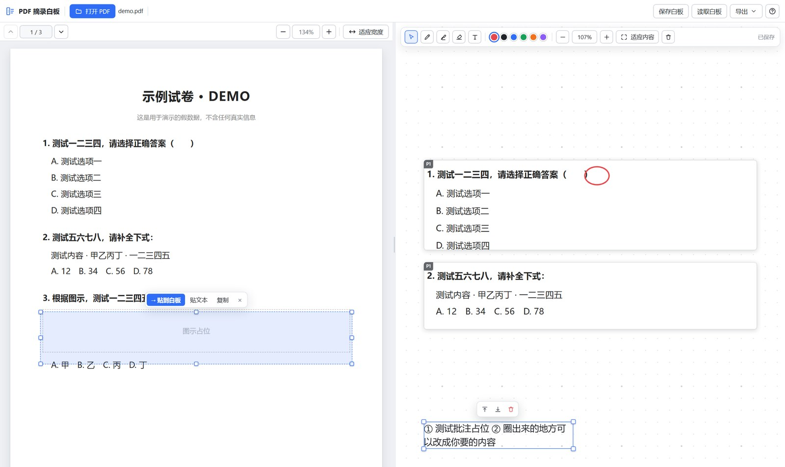

# PDF 摘录白板

**左边读 PDF、右边当白板**：把试卷/资料里的题目**框一下、贴过去**，在白板上拼版、批注，再导出 PNG / PDF。
适合整理错题、拼卷子、把扫描件里的某道题抠出来重新排版。



- 纯前端实现，无框架、无构建、**零运行时依赖**（pdf.js 已内置在 `vendor/`）
- PDF 只在你自己的浏览器里解析，**不会上传到任何服务器**
- 可以纯静态部署（步骤见下文《部署到静态托管》），也可以自托管让白板存服务器、多设备共享

> 手头没有合适的 PDF 想先试试？仓库里放了一份纯占位文字的示例： [`docs/demo.pdf`](docs/demo.pdf)（内容只有"测试一二三四"这类假数据）。

---

## 两种用法

| | 在线版（纯静态） | 自托管（Node / Docker） |
|---|---|---|
| 部署 | 部署到 Vercel / 任意静态托管（见下文步骤） | `node server.mjs` 或 `docker compose up -d` |
| 白板存哪 | 各人自己的浏览器（IndexedDB） | 服务器上的 `data/boards/*.json` |
| 多设备同步 | ✗（换设备是空的） | ✓（连同一地址就是同一套板） |
| 多块白板 / 重命名 | ✗（只有一块，刷新还在） | ✓（顶栏切换 / 新建 / 重命名 / 删除） |
| 适合 | 开源演示、随手用一下 | 长期自用、家里有台小服务器 |

两者**其余功能完全一样**：框选贴图、多色批注、批注跟随题图、文字、撤销、导出 PNG/PDF。

---

## 快速开始（本机）

需要 Node.js 18+：

```bash
node server.mjs          # 打开 http://127.0.0.1:7420/
```

Windows 上也可以直接双击 **`启动 PDF 摘录白板.cmd`**（还能把 PDF 拖到该图标上，启动后自动打开）。
不想用 Node 的话，任意静态服务器都行：

```bash
python -m http.server 7420     # 然后开 http://127.0.0.1:7420/
```

> ⚠️ 不能直接双击 `index.html` 用 `file://` 打开——浏览器会拦截 ES module 和 pdf.js 的 Worker，必须走 http。

---

## 用法（三步）

1. **打开 PDF**：点左上角「打开 PDF」，或直接把 PDF 拖进窗口。
2. **框选**：在左侧页面上按住鼠标拖出一个框 → 出现虚线选框和浮条。
3. **贴到白板**：点浮条上的「**→ 贴到白板**」；或者按 `Ctrl+C`，再点右侧白板按 `Ctrl+V`。

贴过去的是**高清截图**（按当前缩放放大渲染，约 2–4 倍分辨率），放大不糊、导出打印也清楚；PDF 有文字层时还能点「贴文本」把它变成可编辑文字。

---

## 白板能做什么

| 想做的事 | 怎么做 |
|---|---|
| 移动 / 摆放 | 直接拖动；空白处拖框可框选多个一起拖 |
| 缩放单个元素 | 拖四角的小方块（拖角时按 `Shift` 锁定长宽比） |
| 平移画布 | 按住空格拖 / 中键拖 / 右键拖 / 滚轮上下 / `Shift`+滚轮左右 |
| 缩放画布 | `Ctrl`+滚轮，或工具条 `−` `+`；「适应内容」一键看全 |
| 批注 | 工具条「画笔」「荧光笔」，**点色块换颜色**（`1`–`6` 也行），直接画；「橡皮」擦 |
| 批注跟着题图走 | 画在图片上的笔迹会自动跟随该图片移动/缩放；想拆开就 `Alt`+点击 单独选中它再拖走 |
| 选中某条批注 | `Alt`+点击 它（普通点击优先选中图片，避免误操作） |
| 写文字 | 工具条「文字」，双击空白处输入；`Enter` 提交，`Shift+Enter` 换行 |
| 改文字 | 双击已有文字 |
| 调整层次 | `Ctrl+]` 置顶、`Ctrl+[` 置底，或选中后用浮动小工具条 |
| **一键排列** | 工具条「排列 ▾」：左对齐 / 顶部对齐 / 竖向排列 / 横向排列 / 网格排列 / 两列排列 / 思维导图 / **思维导图（带连线）**；选中 2 个以上只排选中的，否则排整块白板 |
| 思维导图连线 | 「思维导图（带连线）」会在中心卡片与每张卡片之间拉灰色细曲线；线会跟着卡片移动/缩放/重排自动重算，删掉卡片线自动消失 |
| 撤销 | `Ctrl+Z` / `Ctrl+Shift+Z` |
| 导出 | 顶部「导出 ▾」→ **PNG 图片**（整块一张图）或 **PDF**（A4 自动分页，切页避开内容） |
| 连续贴多道题 | 贴入会自动往下排成列，不叠在一起 |

---

## 部署到静态托管（以 Vercel 为例）

本项目是**纯静态**的：没有构建命令、不用装依赖、没有服务端、不需要任何环境变量。
发布方式就是**把仓库根目录当静态目录发出去**，需要一起发的是这四样：

```
index.html
css/
js/
vendor/          # 4.6MB，pdf.js 与中文字体，必须一起发
```

### 方式一：Vercel 控制台导入（推荐）

1. 确认你要部署的仓库已经在你自己的 GitHub 账号里（本仓库可直接用，也可以 fork 一份再改）
2. 打开 <https://vercel.com/new>，在 Git 仓库列表里选中它 → **Import**
3. 参数这样填，其余保持默认：

   | 选项 | 填什么 |
   |---|---|
   | Framework Preset | **Other** |
   | Build Command | **留空**（勾掉 Override 即可） |
   | Output Directory | **留空**（默认仓库根目录） |
   | Install Command | **留空** |
   | Environment Variables | **不需要** |

4. 点 **Deploy**，十几秒完成，拿到 `https://<项目名>.vercel.app`

之后每一次往该仓库的默认分支 push，Vercel 都会自动重新部署。

仓库里已经备好的两个文件：

- `vercel.json`：声明无构建、静态资源缓存头与安全头
- `.vercelignore`：把 `server.mjs`、`Dockerfile`、`compose`、`data/` 这些**自托管才需要**的东西排除出发布内容，实际发布约 5MB 静态资源

### 方式二：命令行部署

在本地这个仓库的目录里执行：

```bash
npm i -g vercel
vercel --prod
```

首次会问要不要 link 到某个 Vercel 项目，选新建即可；它部署的是**当前目录里的代码**，不会复制仓库。之后同一个目录再执行 `vercel --prod` 就更新同一个项目。

### 方式三：其他静态托管

Cloudflare Pages / Netlify / Nginx / GitHub Pages 都一样：**根目录当静态目录、不执行构建**。
放在子路径（如 `https://example.com/pdf-board/`）也能正常工作，页面里的资源都是相对路径。

静态版的行为：

- 白板自动存在**访问者自己的浏览器**里（IndexedDB），刷新不丢；不会上传到任何服务器，也没有账号和数据库
- 想清空：点白板工具条的垃圾桶（点两次），或清该站点的浏览器数据
- 因为是 HTTPS，**框选后可以直接把截图写进系统剪贴板**贴到 Word/微信（`http://` 下浏览器会禁用该功能）
- 换设备/换浏览器打开是空白板——本来就没打算存服务端
- 如果你需要"多设备同一套白板"，用下面的自托管方式

---

## 部署到自己的服务器（Docker）

```bash
cd pdf-board
docker compose up -d --build     # 然后开 http://<服务器IP>:7420/
```

白板数据在 `./data`（挂载进容器 `/data`），想要访问口令就设 `PDFBOARD_TOKEN`。
详细步骤（HTTPS、子路径反代、systemd 裸跑、备份迁移）见 [部署到服务器.md](docs/部署到服务器.md)。

自托管模式下打开的是"服务器模式"：白板存在服务器上，多设备共用，顶栏多出「白板 ▾ ＋ ✎ 🗑」可以切换/新建/重命名/删除。

> 注意：PDF 始终是你在浏览器里选本地文件打开（浏览器安全限制，服务器看不到你的 PDF 文件）；存到服务器的只有白板内容。

---

## 快捷键

左侧 PDF：`←` `→` 翻页 · `+` `-` 或 `Ctrl+滚轮` 缩放 · `Esc` 取消选区 · `Ctrl+C` 复制选区
白板：`V` 选择 · `P` 画笔 · `H` 荧光笔 · `E` 橡皮 · `T` 文字 · `1`–`6` 换色 · `Delete` 删除 · `Ctrl+D` 复制 · `Ctrl+A` 全选
全局：`Ctrl+O` 打开 PDF · `Ctrl+S` 保存白板 json · 点右上角 `?` 看完整说明

---

## 目录结构

```
pdf-board/
  index.html            外壳（顶栏、两栏、分割条、帮助弹窗）
  css/app.css           设计令牌 + 外壳样式
  css/pdf-pane.css      左栏 PDF 模块样式
  css/board.css         右栏白板模块样式
  js/app.js             装配层：开文件、剪贴板桥、导出（PNG / PDF）、白板切换与同步
  js/pdf-pane.js        PDF 阅读器 + 框选摘录（pdf.js）
  js/board.js           无限白板引擎（DOM + Canvas）
  server.mjs            本地静态服务器 + 白板存储 API（/api/*，自托管时才需要）
  Dockerfile            容器镜像
  docker-compose.yml    一条命令部署（端口 7420 + ./data 卷）
  vercel.json           纯静态部署配置（无构建）
  启动 PDF 摘录白板.cmd   Windows 双击启动
  创建桌面快捷方式.cmd   Windows 桌面图标
  data/boards/          自托管时的白板数据（运行时生成，备份就拷这里）
  docs/screenshot.jpg  使用示意（用 docs/demo.pdf 录的，内容全是占位文字）
  docs/demo.pdf        示例 PDF（3 页，纯假数据，可拿来直接试框选）
  docs/部署到服务器.md    Docker / HTTPS / 备份
  docs/接口契约.md       模块接口说明（想改代码时看）
  vendor/pdfjs/         pdf.js 4.10.38（含 cmaps、standard_fonts，离线可用）
```

## 技术说明

- **零构建**：原生 ES Module，改完刷新即可，没有打包步骤
- **零依赖**：不引任何 npm 包；pdf.js 4.10.38 直接内置在 `vendor/`（含中文 cMaps 与标准字体）
- **两个模块**：`pdf-pane.js`（左）与 `board.js`（右）互不 import，只通过 `app.js` 传入的回调通信；接口约定见 [接口契约.md](docs/接口契约.md)
- **导出 PDF** 是自己写的极简 PDF 生成器（嵌入 JPEG + 手写 xref），不引 jsPDF
- **白板数据结构**：`{ version, view, items[] }`，元素类型 `image | text | stroke`，世界坐标，可存浏览器也可存文件

## 排查

- **页面空白**：确认是用 http 打开的（不是 `file://`）；看控制台是否有模块/Worker 报错。
- **中文显示成方块**：确认 `vendor/pdfjs/cmaps/` 与 `vendor/pdfjs/standard_fonts/` 还在。
- **粘贴没反应**：`Ctrl+V` 前先点一下右侧白板让它获得焦点；也可能是系统剪贴板里没有可读图片（此时会自动用最近一次 PDF 框选的内容）。
- **自托管时端口被占**：`server.mjs` 会自动改用下一个可用端口，地址以命令行窗口显示为准。

## License

[MIT](LICENSE)
